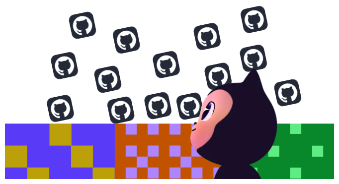
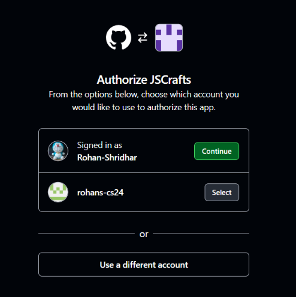

# Building GitHub Authentication: From GitHub App Setup to OAuth Callback


Ever wondered what actually happens when you click **"Continue with GitHub"** on a website?

For JSCrafts, I needed a way to identify users through their GitHub accounts and connect that identity to my application's user database.

I decided to use a GitHub App and implement the authorization flow in Next.js. In this article, I'll walk through the setup, environment variables, authorization redirect, callback handling, and how I connect the authenticated GitHub profile to my database.



Let's break it down step by step.

## Table of contents

## What is a GitHub App?
A GitHub App is like a formal partnership agreement between your application and GitHub users.

Imagine building a passport automation system where you need to authenticate new users. Forget the technical jargon for a moment. Think of it this way: just as a Social Security Number (SSN) can help uniquely identify an individual, GitHub authentication allows your app to identify and verify users through their GitHub accounts.

## Why I Chose a GitHub App?

GitHub offers several ways to authenticate users and access its resources, including Personal Access Tokens, OAuth Apps, and GitHub Apps. Each serves a different purpose, but I needed an approach that would support user authentication while allowing my application to request specific permissions for GitHub resources.

I chose a **GitHub App** because it offers granular permissions and supports acting both as an application and on behalf of authorized users. This made it a suitable fit for my application's authentication and integration requirements.

## Phase 1: Creating a GitHub App
I started by navigating to:

GitHub → Settings → Developer settings → GitHub Apps → New GitHub App

> *GitHub Apps are registered through the Developer settings section of a GitHub account or organization.*

Configured the basic details: 
1. Tha callback URL:  
The callback URL is the address GitHub sends the user back to after they approve (or deny) login on GitHub's site.
    > *Where do you want the user to be sent after github app does its job?*

    I registered every URL I will be using
Development: http://localhost:3000/api/auth/github/callback  
Production: https://jscrafts.vercel.app/api/auth/github/callback

2. Permissions  
Permissions determine what a GitHub App can access or modify. Granting excessive permissions increases the potential impact of a compromised application.

    For the initial setup, I kept repository access read-only and limited the permissions to the requirements of the integration.
3. Webhooks  
GitHub webhooks allow an application to receive event notifications, such as repository-related changes, without continuously polling the API.

    I planned to use a webhook endpoint for future repository integration, but the endpoint had not yet been implemented.

    Therefore, I deferred webhook configuration until the application had a working endpoint. When webhooks are enabled, the webhook URL and secret must be configured appropriately.
4. Creating the .env.local File
I added the following environment variable names:
```env
    GITHUB_CLIENT_ID=
    GITHUB_CLIENT_SECRET=
    GITHUB_APP_ID= 
    GITHUB_PRIVATE_KEY=
    GITHUB_WEBHOOK_SECRET=
````
|Value|Meaning| Usecase |
|--|--|--|
|GITHUB_CLIENT_ID|A public identifier for the github app. Like a username.|It appears in the URL when redirecting users to GitHub|
|GITHUB_CLIENT_SECRET|A secret password for the app. Like a password paired with the client ID.|Exchanging the authorization code for an access token|
|GITHUB_APP_ID|A numeric ID for the GitHub App itself |When your application wants to read repositories on its own behalf.|
|GITHUB_PRIVATE_KEY| A cryptographic key (.pem file) that proves "I really am the GitHub App."|Generating JWTs to authenticate as the GitHub App itself, used later|
|GITHUB_WEBHOOK_SECRET|A shared password used to verify that incoming webhook requests actually came from GitHub.|The eventual /api/github/webhook route |

## Phase 2: Implement GitHub Login
Before implementing, understand the actors in our implementation.  
The browser is the user, your app server, GitHub's website and GitHub's API.   
We need two separate routes to complete the entire flow.  
### Route 1: Send the user to GitHub.  
The URL looks like this:
```https
    https://github.com/login/oauth/authorize
    ?client_id=[GITHUB-CLIENT_ID]
    &redirect_uri=[CALLBACK_URL]
````
The file you need create is `src/app/api/auth/github/route.ts`:
````js
export async function GET() {
  // 1. Read the client ID from env
  const clientId = process.env.GITHUB_CLIENT_ID;
  if (!clientId) {
    return NextResponse.json(
      { error: 'GitHub client ID is not configured' },
      { status: 500 },
    );
  }

  // 2. Figure out which callback URL to use
  const redirectUri =
    process.env.NODE_ENV === 'production'
      ? 'https://jscrafts.vercel.app/api/auth/github/callback'
      : 'http://localhost:3000/api/auth/github/callback';

  // 3. Build the GitHub URL
  const githubUrl = new URL('https://github.com/login/oauth/authorize');
  githubUrl.searchParams.set('client_id', clientId);
  githubUrl.searchParams.set('redirect_uri', redirectUri);

  // 4. Send the browser there
  return NextResponse.redirect(githubUrl);
}
````  
When the browser lands on that URL, github checks the client_id and responds to the real Github App.  
If they approve --> redirect to the callback url along with `?code=ABC123`  
If they deny --> redirects back with `?error=access_denied`  
The code that it sends back when approved is important, its short-lived, single-use and is used with CLIENT_ID for fetching github user details for initial profile building.  

### Route 2: Receive the user back from GitHub  
The file you need to `src/app/api/auth/github/callback/route.ts`  
This is the meat of the login. It does four things in order:  
#### Part 1: Read the code or error
```js
export async function GET(request: NextRequest) {
  const searchParams = request.nextUrl.searchParams;
  const code = searchParams.get('code');
  const error = searchParams.get('error');

  if (error) {
    return NextResponse.redirect(new URL('/?error=github_denied', request.url));
  }

  if (!code) {
    return NextResponse.redirect(new URL('/?error=missing_code', request.url));
  }
  // ... continue
}
````  
#### Part 2: Exchange code for access token  
```js
const tokenResponse = await fetch('https://github.com/login/oauth/access_token', {
  method: 'POST',
  headers: {
    Accept: 'application/json',
    'Content-Type': 'application/json',
  },
  body: JSON.stringify({
    client_id: clientId,
    client_secret: clientSecret,
    code,
    redirect_uri: redirectUri,
  }),
});

const tokenData = await tokenResponse.json();

if (!tokenResponse.ok || !tokenData.access_token) {
  return NextResponse.redirect(new URL('/?error=github_token_exchange', request.url));
}
````  
#### Part 3: Fetch the user's profile  
```js
const githubUserResponse = await fetch('https://api.github.com/user', {
  headers: {
    Authorization: `Bearer ${tokenData.access_token}`,
    Accept: 'application/vnd.github+json',
  },
});

const githubUser = await githubUserResponse.json();
````  
GitHub returns something like this:  
```json
{
  "id": 12345678,
  "login": "rohan",
  "name": "Rohan",
  "avatar_url": "https://avatars.githubusercontent.com/u/...",
  "html_url": "https://github.com/rohan"
}
````  
#### Part 4: Create the JSCrafts user  
```js
await connectDB();

const user = await User.findOneAndUpdate(
  { githubId: String(githubUser.id) },
  {
    githubId: String(githubUser.id),
    username: githubUser.login,
    displayName: githubUser.name ?? githubUser.login,
    avatarUrl: githubUser.avatar_url,
    profileUrl: githubUser.html_url,
    email: primaryEmail,
  },
  {
    new: true,   // return the updated document
    upsert: true, // create it if it doesn't exist
  },
);
````  
What findOneAndUpdate with upsert: true does:

```txt
1. Look for a User with githubId = "12345678"
2. If found → update its fields, return it
3. If not found → create a new User with all these fields, return it
This is the classic "find-or-create" pattern. It handles both first-time and returning users in a single query.
```

*Why use githubId as the key?*

* It's stable — usernames can change, IDs can't.

* It's unique — each GitHub account has exactly one ID.

Why `new: true` ?   
    Without it, MongoDB returns the old document (before the update). With it, you get the new one, which is what you want for the session step.

---
## What I Learned
Building GitHub authentication for JSCrafts helped me understand three important things:

* **Permission scoping matters:** Request only the access your application actually needs.
* **OAuth security matters:** State validation, secure credential handling, and proper error handling are essential parts of the flow.
* **Authentication has multiple layers:** Authenticating a user through GitHub is different from authenticating the GitHub App itself.

This is an important step in building JSCrafts. The next step is to ensure that the authorization flow is backed by secure session management and that every protected route checks the user's session