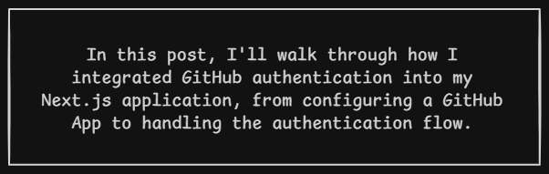

# Elucidating GitHub App Authentication | Simple Walkthrough 



## Table of contents

## What is a GitHub App?
A GitHub App is like a formal partnership agreement between your application and GitHub users.

Imagine building a passport automation system where you need to authenticate new users. Forget the technical jargon for a moment. Think of it this way: just as a Social Security Number (SSN) can help uniquely identify an individual, GitHub authentication allows your app to identify and verify users through their GitHub accounts.

## Why I Chose a GitHub App?

GitHub offers several ways to authenticate users and access its resources, including Personal Access Tokens, OAuth Apps, and GitHub Apps. Each serves a different purpose, but I needed an approach that would support user authentication while allowing my application to request specific permissions for GitHub resources.

I chose a **GitHub App** because it offers granular permissions and supports acting both as an application and on behalf of authorized users. This made it a suitable fit for my application's authentication and integration requirements.

## Phase 1: Creating a GitHub App
I started by navigating to:

GitHub → Settings → Developer settings → GitHub Apps → New GitHub App

> *GitHub Apps are registered through the Developer settings section of a GitHub account or organization.*

Configured the basic details: 
1. Tha callback URL:  
The callback URL is the address GitHub sends the user back to after they approve (or deny) login on GitHub's site.
    > *Where do you want the user to be sent after github app does its job?*

    I registered every URL I will be using
Development: http://localhost:3000/api/auth/github/callback
Production: https://jscrafts.vercel.app/api/auth/github/callback

2. Permissions  
Permissions determine what a GitHub App can access or modify. Granting excessive permissions increases the potential impact of a compromised application.

    For the initial setup, I kept repository access read-only and limited the permissions to the requirements of the integration.
3. Webhooks  
GitHub webhooks allow an application to receive event notifications, such as repository-related changes, without continuously polling the API.

    I planned to use a webhook endpoint for future repository integration, but the endpoint had not yet been implemented.

    Therefore, I deferred webhook configuration until the application had a working endpoint. When webhooks are enabled, the webhook URL and secret must be configured appropriately.
4. Creating the .env.local File
I added the following environment variable names:
```env
    GITHUB_CLIENT_ID=
    GITHUB_CLIENT_SECRET=
    GITHUB_APP_ID= 
    GITHUB_PRIVATE_KEY=
    GITHUB_WEBHOOK_SECRET=
````
|Value|Meaning| Usecase |
|--|--|--|
|GITHUB_CLIENT_ID|A public identifier for the github app. Like a username.|It appears in the URL when redirecting users to GitHub|
|GITHUB_CLIENT_SECRET|A secret password for the app. Like a password paired with the client ID.|Exchanging the authorization code for an access token|
|GITHUB_APP_ID|A numeric ID for the GitHub App itself |When your application wants to read repositories on its own behalf.|
|GITHUB_PRIVATE_KEY| A cryptographic key (.pem file) that proves "I really am the GitHub App."|Generating JWTs to authenticate as the GitHub App itself, used later|
|GITHUB_WEBHOOK_SECRET|A shared password used to verify that incoming webhook requests actually came from GitHub.|The eventual /api/github/webhook route |